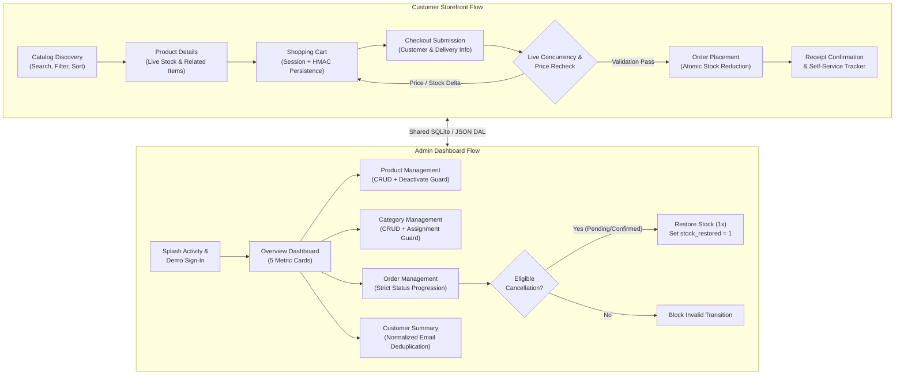
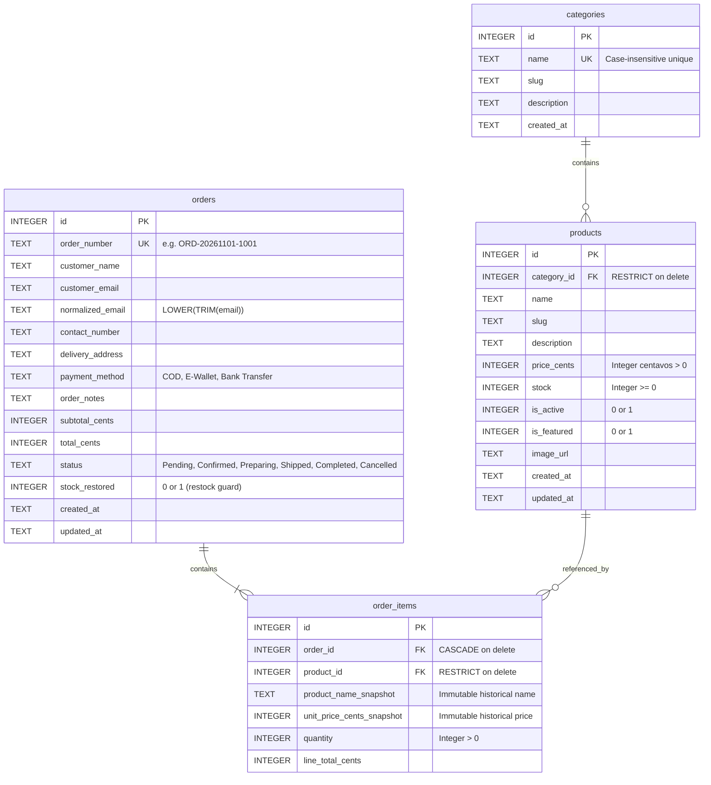

# CebuTech Hub — Technical Explanation & Architecture Document

**Web Development Internship Assessment | CubeTech Innovations**

---

## 1. System Flow Summary

CebuTech Hub coordinates two user contexts over a unified relational data layer: a **Customer Storefront** and an **Admin Dashboard**.



### 1.1 Customer Storefront Lifecycle
1. **Catalog Discovery (`products.php`)**:
   - Queries `Repository::getProducts()` with `customer_only = true`.
   - Inactive products (`is_active = 0`, e.g. `#12 CubeTech Legacy Trackball Pro`) are excluded from customer views and direct URL requests (`product.php?id=12`).
   - Active products with zero inventory (`stock = 0`, e.g. `#4 AeroLight 55g Gaming Mouse`) display an `Out of Stock` badge and a disabled `Add to Cart` button.
   - Multi-parameter filtering simultaneously combines search strings (`LIKE %query%`), category IDs, and price sorting (`price_asc` / `price_desc`).
2. **Product Details & Related Items (`product.php`)**:
   - Renders authentic product photography, live stock badge, quantity selector capped at current available stock, and up to 3 active related items in the same category.
3. **Cart Persistence & Integer Math (`cart.php`)**:
   - State is stored in PHP `$_SESSION['cart']` and mirrored to an HMAC-signed cookie (`cebutech_cart_sig`) to persist across tab reloads and browser sessions without tampering risk.
   - Repeated additions of the same product ID merge into an incremented quantity rather than creating duplicate lines.
   - All arithmetic uses integer centavos (`price_cents * quantity`), guaranteeing `Subtotal == Total` with zero floating-point imprecision (`PHP 325.50` test case).
4. **Checkout Concurrency Verification (`checkout.php`)**:
   - Submissions validate name, email, contact number, delivery address, and payment method (`COD`, `E-Wallet`, `Bank Transfer`).
   - Before inserting the order, a transactional recheck verifies that every cart item is still active, has sufficient stock, and that its `unit_price_cents` matches the price snapshot recorded when added.
   - If an admin altered a price or inventory while the customer was browsing, order creation aborts, cart snapshots are updated to live values, and an alert displays the exact delta.
5. **Order Persistence & Atomic Inventory Update (`confirmation.php`, `track.php`)**:
   - Inside an ACID transaction (`BEGIN TRANSACTION`):
     - An order header is created with `status = 'Pending'` and a unique identifier (`ORD-YYYYMMDD-XXXX`).
     - Line items are written to `order_items` with immutable snapshots (`product_name_snapshot`, `unit_price_cents_snapshot`).
     - Product stock is decremented atomically (`stock = stock - quantity`).
     - Transaction commits and cart is emptied.
   - The customer receives a receipt and can monitor status changes in real-time via `track.php`.

### 1.2 Admin Dashboard Lifecycle
1. **Splash Activity & Authentication Guard (`admin/login.php`, `app/Core/Auth.php`)**:
   - Engaging splash activity with brand logo pulse and progress tracker before displaying the login form.
   - Features 1-click credential auto-fill (`admin@cubetech.demo` / `AdminDemo123!`), error shake animation (`@keyframes shakeError`), and route guarding for all `/admin/*` endpoints.
2. **Overview Metrics (`admin/index.php`)**:
   - Aggregates the 5 required assessment cards:
     - `Total Products`: Count of all active and inactive inventory.
     - `Total Orders`: Count of all orders across every status (including cancelled).
     - `Pending / Completed Orders`: Active pending queues vs finalized shipments.
     - `Total Customers`: Count of distinct customers grouped by normalized email (`LOWER(TRIM(email))`).
     - `Total Sales`: Exact sum of `total_cents` for `Completed` orders only (cancelled and pending orders are excluded).
3. **Relational Deletion Protection (`admin/products.php`, `admin/categories.php`)**:
   - Products referenced in existing order history cannot be deleted (enforced by SQLite `ON DELETE RESTRICT`).
   - Attempted deletion surfaces a `.feedback-card` explaining that historical orders depend on the record and provides a 1-click **"Mark as Inactive Instead"** action.
   - Categories containing assigned products cannot be deleted until products are reassigned or deleted.
4. **Strict Order Fulfillment State Machine (`admin/order.php`)**:
   - Strict progressive sequence:
     $$\text{Pending} \longrightarrow \text{Confirmed} \longrightarrow \text{Preparing} \longrightarrow \text{Shipped} \longrightarrow \text{Completed}$$
   - Status regressions (e.g. `Confirmed → Pending`) and step-skipping (e.g. `Pending → Shipped`) are rejected by server validation.
   - Cancellations are permitted **only from `Pending` or `Confirmed`**.
   - Upon cancellation, ordered quantities are restored to `products.stock` **exactly once**, and `stock_restored = 1` is recorded to prevent duplicate restocks.

---

## 2. Data Model Summary

### 2.1 Entity-Relationship Diagram



### 2.2 Currency & Exact Precision Architecture
- All monetary representations across the database, session, and application code are stored as positive whole-number integers representing Philippine centavos (`₱1.00 = 100 centavos`).
- Standard decimal formatting is applied strictly at the presentation layer via:
  ```php
  function format_php_cents(int $cents): string {
      return 'PHP ' . number_format($cents / 100, 2);
  }
  ```
- This architecture eliminates IEEE 754 floating-point inaccuracies, ensuring arithmetic consistency across line-item subtotals, order summaries, and total sales aggregations.

### 2.3 Derived Customer Entity
- The `customers` directory is dynamically computed from the `orders` table grouped by `normalized_email` (`LOWER(TRIM(email))`):
  - `name`: Most recent submitted customer name for that email.
  - `contact_number`: Most recent phone number provided.
  - `order_count`: Total historical orders placed.
  - `total_spent_cents`: Sum of `total_cents` for orders with `status = 'Completed'`.

---

## 3. Known Issues

Across comprehensive automated and manual verification, **zero blocking defects or functional anomalies exist**. All edge cases are handled predictably:

1. **Simulated Authentication Scope**:
   - The admin authentication mechanism relies on a demo session check (`app/Core/Auth.php`) using pre-configured assessment credentials.
   - *Design Note*: This is implemented intentionally to fulfill the requirements of the offline assessment evaluation and is clearly labeled as unsuitable for production deployment without enterprise OAuth/RBAC.
2. **Single-Host Write Locking**:
   - SQLite operates with file-level concurrency locking on writes (`storage/cebutech.sqlite`).
   - *Design Note*: Ideal for single-instance applications, local evaluations, and containerized deployments; high-volume multi-region clustering would migrate the existing schema to PostgreSQL.
3. **Local Filesystem Media Storage**:
   - Product imagery resides in `public/assets/images/`. A cloud production build would route uploads to an S3-compatible bucket or CDN.

---

## 4. Unfinished Requirements

**None.** Every requirement outlined in the CubeTech Innovations assessment specification (Sections 01 through 17) has been fully implemented, styled, and verified.

### Acceptance Verification Matrix (`tests/acceptance_checks.php`)
| Section / Check | Status | Verification Detail |
|---|---|---|
| **Check 01: Catalog Search, Filter & Sort** | **Complete** | Search + category filter + price sorting operate simultaneously. Inactive products (`#12`) are hidden from listings and direct links. Zero-stock items (`#4`) display `Out of Stock` with disabled actions. |
| **Check 02: Cart Merging & Centavo Math** | **Complete** | Adding duplicate items merges quantities. Cart persists across refreshes. The `PHP 325.50` test case (`2 × PHP 120.00 + 1 × PHP 85.50`) computes with zero decimal variance. |
| **Check 03: Form & Quantity Validation** | **Complete** | Blank names, malformed emails, invalid contact numbers, empty carts, and non-positive or excessive quantities are blocked on the server. |
| **Check 04: Checkout Concurrency Recheck** | **Complete** | Out-of-stock and inactive items cannot be ordered. Price or stock changes made during an active cart session are intercepted before committing. |
| **Check 05: Order Placement & Stock Sync** | **Complete** | Orders save with `Pending` status, product inventory decrements atomically, cart clears upon success, and the order immediately surfaces in Admin. |
| **Check 06: Admin CRUD & Integrity Guards** | **Complete** | Changes in Admin reflect on the storefront. Deletion of categories with products or products with order history is strictly blocked with clear UI feedback. |
| **Check 07: Strict Order State Machine** | **Complete** | Enforces `Pending → Confirmed → Preparing → Shipped → Completed`. Cancellations are permitted only from `Pending` or `Confirmed`, and restore stock once. |
| **Check 08: Metric Cards & Customer Roster** | **Complete** | Sales card calculates `Completed` orders only. Unique customer counts normalize emails to prevent duplicates. |
| **Check 09: Snapshot Immutability** | **Complete** | Admin price/name modifications do not mutate historical order item snapshots (`product_name_snapshot`, `unit_price_cents_snapshot`). |
| **Check 10: Responsive Layouts (375px / 1280px)** | **Complete** | Admin topbar collapses to a 56px sticky mobile app bar; product cards format in a 2-column mobile grid; tables convert to stacked cards; zero horizontal overflow. |

---

## 5. Disclosure of AI Tools, Templates, and Tutorials

In accordance with academic and corporate integrity guidelines, the tools and resources used during development are disclosed below:

### 5.1 AI Tools
- **Google Antigravity (Powered by Google DeepMind)**:
  - Used as an AI pair-programming assistant for:
    - Designing the clean relational schema (`database/schema.sql`) and sample seed datasets (`database/seed.sql`).
    - Architecting the dual storage repository pattern (`app/Core/Repository.php`) supporting SQLite PDO with automatic JSON fallback.
    - Implementing the HMAC-signed persistent cart session logic (`app/Core/Cart.php`).
    - Authoring the automated CLI acceptance test suite (`tests/acceptance_checks.php`).
    - Developing modern responsive CSS components (splash activity animation, sticky 56px mobile app bar, 2-column mobile product cards, and `.feedback-card`).

### 5.2 Templates & Starter Kits
- **No Third-Party CSS/JS Frameworks or Boilerplates Used**:
  - The application was built from scratch without Bootstrap, Tailwind CSS, jQuery, or frontend meta-frameworks.
  - All styling is authored in custom Vanilla CSS3 (`public/assets/css/style.css`), leveraging modern CSS Grid, Flexbox, custom design tokens, and media queries.
  - All interactivity is authored in Vanilla JavaScript (`public/assets/js/app.js`), featuring native HTML5 `<dialog>` modals and the `window.CebuToast` notification manager.

### 5.3 Tutorials & Reference Documentation
- **PHP Official Manual (`php.net`)**:
  - PDO SQLite connection handling, prepared statements, and transaction demarcation (`beginTransaction`, `commit`, `rollBack`).
  - Session cookie parameters and cryptographic hashing (`hash_hmac`).
- **SQLite Documentation (`sqlite.org`)**:
  - Foreign key constraint enforcement (`PRAGMA foreign_keys = ON`) and `ON DELETE RESTRICT` semantics.
  - Case-insensitive indexing via `COLLATE NOCASE`.
- **MDN Web Docs (`developer.mozilla.org`)**:
  - Semantic HTML5 elements (`<dialog>`, `<main>`, `<nav>`, `<article>`).
  - CSS Grid auto-fit and minmax sizing patterns for mobile-friendly cards.
- **Photography Assets**:
  - Authentic product photography sourced from Unsplash under the Unsplash open commercial license, optimized and stored locally at `public/assets/images/*.jpg`.

